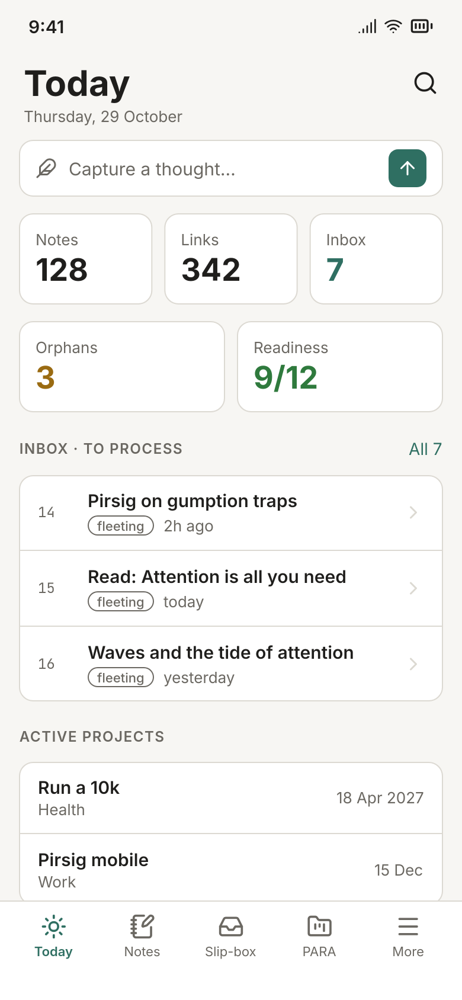
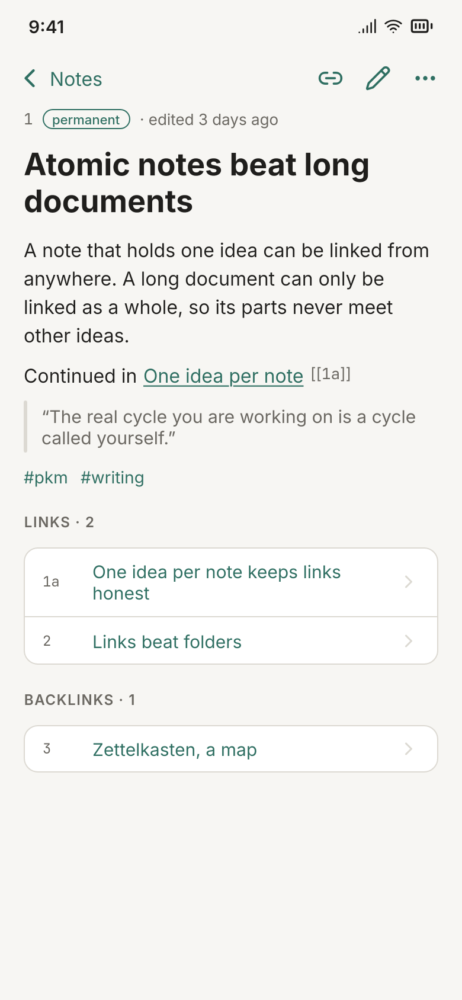

# Mobile screens

A first pass at Pirsig on a phone: the desktop app's views, reshaped for one hand. The
sidebar becomes a tab bar (Today, Notes, Slip-box, PARA, More) and quick capture becomes a
sheet. Colours, kinds and words come from the desktop app (`desktop/dist/app.css` and the
views in `desktop/dist/js/views/`), so the two read as one app.

The screens were drawn in [OpenPencil](https://github.com/open-pencil/open-pencil) through
its MCP server, at 390×844 and exported at 2×. They are mock-ups with sample data, not
screenshots of a build.

| Today | Notes | Note |
|---|---|---|
|  |  |  |

| Slip-box | Project | Capture |
|---|---|---|
|  |  |  |

What the screens map to:

| Screen | Desktop view | API |
|---|---|---|
| Today | `#/` (`today.js`) | `/api/slipbox/stats`, `/api/readiness`, `/api/slipbox/inbox`, `/api/projects`, `/api/tasks` |
| Notes | `#/notes` | `/api/notes` |
| Note | `#/notes/:zid` | `/api/notes/:zid` |
| Slip-box | `#/slipbox/:tab` | `/api/slipbox/{inbox,orphans,tree}`, `/api/slipbox/stats` |
| Project | `#/projects/:id` | `/api/projects/:id`, `/api/projects/:id/notes`, `/api/tasks` |
| Capture | the sidebar's capture form | `POST /api/notes` |

Not drawn yet: Hippos, Areas, Resources, Feeds and arXiv, Plasticity, Readiness, the note
editor, and dark mode.
