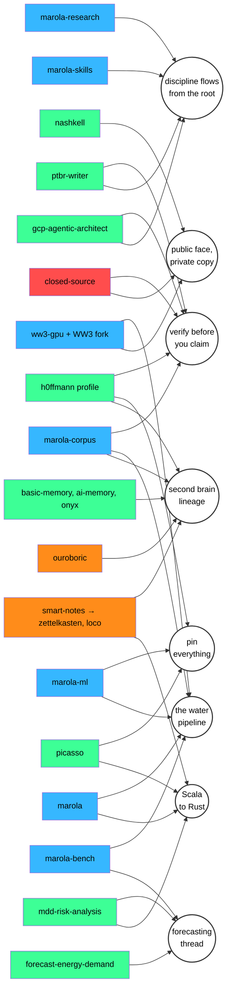

# Use cases: a second brain made of your own repositories

These use cases take one real person's GitHub, [h0ffmann](https://github.com/h0ffmann), and turn it
into a ztk brain: the repositories go into PARA, what their READMEs say becomes notes, and the ties
between the ideas become notes of their own. The worked result is in
[`examples/slipbox/`](../examples/slipbox/): a PARA seed script that runs on today's `ztk`, and a
29-note slip box that follows the owner's own slip-box rules
([h0ffmann/h0ffmann, `NOTES.md`](https://github.com/h0ffmann/h0ffmann/blob/main/NOTES.md)).

The slip box was written by hand from the READMEs, read on 2026-10-27. Importing repositories
automatically (git as an inbound source) is designed in
[`docs/design/git-inbound.md`](design/git-inbound.md); these notes show what that importer should
produce.

Only public repositories are used. Private ones (ww3-gpu, nagori) appear only through what public
pages already say about them.

## What went in

| Light (area) | Repositories | Forks |
|---|---|---|
| Water | marola, marola-research (marola-bench), marola-corpus, marola-ml, marola-skills, awesome-ocean-science, ww3-gpu (its public pages) | WW3, WW4, wavespectra |
| Ideas | picasso, nashkell, ptbr-writer, forecast-energy-demand, gcp-agentic-architect, mdd-risk-analysis, the profile h0ffmann/h0ffmann | scivolo |
| Ouroboric | ouroboric, zettelkasten, smart-notes | loco, basic-memory, ai-memory, onyx |
| Closed source | closed-source | |

The four areas are the profile's "four lights" (`DESIGN.md`): every work has exactly one, set by
hand. They make a good PARA top level because the owner already uses them that way.

## The ideas and how they connect

Each literature note holds one idea from one README. The eight permanent notes are the ties: each
one names a rule or a story that runs through several repositories.



What the threads say, in one line each (the notes have the sources):

- **Verify before you claim.** closed-source cites every reference, marola-corpus deletes what its
  source does not hold, ptbr-writer marks `⚠`, gcp-agentic-architect marks `(v)` or `⚠`, and the
  profile's notes carry a `status`. Five repositories, one rule.
- **Discipline flows from the root.** marola-research says its rules came from closed-source,
  ww3-gpu, picasso and marola; gcp-agentic-architect borrowed ww3-gpu's shape; the profile's slip
  box is closed-source's and marola-research's discipline "brought here".
- **Pin everything.** picasso pins toolchains, marola-gpt pins its corpus and base model, the
  corpus ships as a pinned tarball, the profile's graph is placed by hand so it never moves.
- **The water pipeline.** WW3 → ww3-gpu → marola → marola-bench → marola-corpus → marola-gpt.
- **The second brain lineage.** smart-notes → ouroboric-dev/zettelkasten → this fork, next to the
  profile's slip box, marola-corpus and three forks of other people's memory tools.
- **A public face and a private working copy.** nashkell (English on disk, Latin in git), ww3-gpu
  (closed for now), nagori (private), against closed-source's "publish the method". This one is
  an open question.
- **The forecasting thread.** Drawdown of a price (2017), weather in a demand forecast (the thesis),
  waves against buoys (marola-bench): honest evaluation, three times.
- **From Scala to Rust.** The first Scala at UFRJ, then Scala at work and in marola's app, then
  Rust for picasso, marola's tooling, scivolo and ztk.

Ties come in two strengths, and the notes keep them apart. A tie that a record states (a Zenodo
record, a `refs.bib`, a README saying "came from") is `verified`. A tie a reader noticed is
`partial` until the owner approves it. All eight permanent notes are `partial`: approving or
rejecting them is the owner's job, and it is a task in the seed.

## Use cases

### 1. Lay your GitHub out in PARA (works today)

Areas are the lights, projects are the open outcomes, resources are the repositories and forks,
and the archive holds what GitHub marks archived.

```sh
cargo build --bin ztk
DATABASE_URL="sqlite://$PWD/slipbox.sqlite?mode=rwc" ZTK=target/debug/ztk examples/slipbox/para.sh
```

The script creates 4 areas, 6 projects (marola-bench v1, the ww3-gpu port, marola-gpt 0.1.0,
the ptbr-writer extension, ztk v0, closed-source v1), 4 tasks, 24 resources and 3 archived ones,
then prints `ztk para`.

### 2. One README, several literature notes

A README holds more than one idea. closed-source gives three notes: the thesis
([publish the method](../examples/slipbox/notes/202610270300-publish-the-method.md)), its root
([science never closes](../examples/slipbox/notes/202610270301-science-never-closes.md)) and its
tool ([paper fabric](../examples/slipbox/notes/202610270302-paper-fabric-checks-every-reference.md)).
Each note's `source` names the repository and the file; with an importer it should also pin the
commit, so the note can be checked against what it read.

### 3. Load the slip box into ztk and walk the graph (works today)

```sh
DATABASE_URL="sqlite://$PWD/slipbox.sqlite?mode=rwc" ZTK=target/debug/ztk python3 examples/slipbox/load.py
ztk box stats        # 30 notes, 93 links: 1 hub, 21 literature, 8 permanent; 0 orphans
ztk note -s 21       # "Verify before you claim", with its links and backlinks
ztk box graph        # nodes and edges as JSON
```

`load.py` turns each file into a `ztk note` with its kind, source and tags, rewrites the
`[[<id>-<slug>]]` links to `[[Title]]` (which ztk resolves on save), and files the index as the hub
note. ztk notes have no status yet, so the status rides along as a `status/<status>` tag.

### 4. Find the threads between repositories

The permanent notes are the point of the exercise: a question no single README answers, like
"where else do I insist on verification?". With notes and backlinks in ztk, that question is a
backlink query (`ztk note -s`) on [verify before you claim](../examples/slipbox/notes/202610270320-verify-before-you-claim.md).

### 5. Trace where a convention came from

"Why does gcp-agentic-architect mark claims `(v)`?" Follow the links: gcp-agentic-architect →
[discipline flows from the root](../examples/slipbox/notes/202610270321-discipline-flows-from-the-root.md)
→ ww3-gpu. The same walk explains marola-research's rules and the profile's slip box.

### 6. Keep forks as prior art, not as your work

A fork is somebody else's idea that you keep near you. In the PARA map a fork is a resource with
"(fork)" in its title, tied to the project it informs: basic-memory, ai-memory and onyx inform
ztk v0; WW3 informs the ww3-gpu port. In the slip box a fork gets a literature note
([three forks are prior art](../examples/slipbox/notes/202610270330-forks-as-prior-art.md)), never a
permanent one: the claim in it is the other project's.

### 7. Review before you trust

Every note carries a `status`. The slip box starts with 21 literature notes at `verified` (the
README was read and says it), 7 permanent notes at `partial` and one at `open-question`. A review
pass moves a note to `approved` or deletes it. `cargo test --test mod slipbox` checks the format:
ids, front matter, no dead links, every note linked from the index; the `zk-method` skill's lint
(`python3 .claude/skills/zk-method/scripts/zk_lint.py examples/slipbox/notes`) reports no findings.

## What this asks of ztk

- **Notes, links, backlinks and tags** are in ztk now (`ztk note`, `ztk link`, `ztk box`).
  Still missing: a **status** on notes (`unverified` → `verified` → `approved`). The Markdown
  **import** exists now: `ztk obsidian import examples/slipbox/notes` loads the same 30 notes
  and 93 links as `load.py`, resolving the `[[<id>-<slug>]]` links by file name. The only
  thing it leaves out is `status`, which is a key/value tag (not built yet) and which
  `load.py` turns into a `status/<status>` label.
- **A git inbound importer** that reads a repository's README (and `notes/`, when it has one)
  into literature notes, pinned at a commit, with the repository as a PARA resource.
- **Labels** for the lights (the first tag of each note), as the BYOL design proposes.
- **Review states** as a workflow: list `partial` notes, approve or reject.
- **Publishing as a separate, explicit step**, so a brain made from public and private repositories
  only shows what its owner chose.
